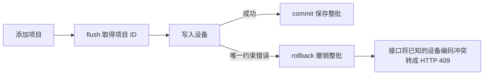

# SQLAlchemy 与 Alembic 实战课件

对应 [课程计划](../course-plan.md)。课程目录为 `D:\myskills\SQLAIchemy-AIembic-skill`，在 VS Code 集成 PowerShell 中逐步操作。课程计划中的目标与下方已记录的实验材料共同构成每课课件。互动时每次“继续”只推进一个步骤。实际输出、报错和自测继续保存在独立实验笔记。历史笔记中出现 CMD 命令时，复做前先按课程计划转换为 PowerShell 语法。


---

## 第 1 课｜从空库搭出项目和设备表

### 目标、知识与验收

**工单**：新同事拿到仓库，需要在本机初始化数据库并看到项目和设备。

- **知识点**：Engine、Session、SQLAlchemy 2.0 的 `Mapped` 和 `mapped_column`、主外键、唯一约束。
- **操作**：建 `projects` 和 `devices`，设备通过 `project_id` 归属项目，练习约定同项目内设备编码唯一。配置 Alembic 的 `target_metadata`，审查初始迁移，再用 `alembic upgrade head` 建表。另写可重复执行的种子脚本，按稳定的业务键写入两个项目和若干设备。
- **失败对照**：尝试写入不存在的项目 ID，观察数据库拒绝。遗漏模型导入时，检查自动生成结果与预期表清单。
- **验收**：另一套空库能通过迁移和种子脚本初始化。种子跑两次，行数保持一致。自测：为何只改 ORM 类以后，数据库结构还没有变化？

### 操作与已有实验记录

#### 实验 01｜从空库搭出项目和设备表

##### 工单与验收

用现有迁移初始化 PostgreSQL，在两套库里写入相同的样例数据。重复运行种子脚本后预期仍为 2 个项目、3 台设备。插入引用不存在项目的设备时，预期 PostgreSQL 拒绝写入。

##### 知识点

- Engine 管理连接，Session 管理 ORM 查询、写入和事务。种子脚本用 flush 取得新项目的主键，事务块成功退出后提交。
- 主键标识单行。devices.project_id 通过外键引用 projects.id。联合唯一约束 (project_id, code) 允许不同项目各有一台 sensor-01。
- 模型导入后将表定义登记到 Base.metadata。Alembic 的自动生成比较数据库现状与 target_metadata，生成候选脚本。执行 upgrade 才改变数据库结构。
- 种子脚本先按项目编码找到项目，再用项目 ID 和设备编码查找设备。先查后写支持本课的串行重复运行。
- 本机通过 127.0.0.1:55432 访问数据库。同一 Compose 网络中的其他容器使用 db:5432。docker compose exec db 启动的 psql 在数据库容器内运行，本课命令默认走 Unix 套接字。

##### 命令与预期

在课程目录的 CMD 中逐行执行命令。切换库时，在同一个窗口用 set 设置 DATABASE_URL，将连接串末尾的库名设为 p29_lab 或 p29_lab_repro。

| 阶段 | 命令或操作 | 预期 |
|---|---|---|
| 准备环境 | docker compose up -d、py -m venv .venv、.venv\Scripts\activate.bat | PostgreSQL 启动，CMD 提示符出现 (.venv) |
| 检查空库 | docker compose exec db psql -U p29 -d p29_lab -c "\dt" | 无可见表 |
| 检查模型 | python -c "from models import Base; print(list(Base.metadata.tables))" | projects 和 devices |
| 初始化迁移环境 | python -m alembic init migrations | 生成 alembic.ini、migrations/env.py 和 versions 目录 |
| 对照实验 | 将 target_metadata 设为 MetaData()，运行 python -m alembic revision --autogenerate -m "demo empty metadata" | 空库与空表清单相同，upgrade() 只有 pass 和注释。审查后删除未执行的演示脚本 |
| 正式迁移 | 导入 models.Base，将 target_metadata 设为 Base.metadata，再运行 python -m alembic revision --autogenerate -m "create projects and devices" | 先建 projects，再建 devices，核对主键、外键和唯一约束 |
| 执行迁移 | python -m alembic upgrade head | 出现 projects、devices、alembic_version |
| 重跑种子 | python c1-seed.py，查行数后再运行一次并复查 | 两次均为 2 个项目、3 台设备 |
| 复现 | 创建 p29_lab_repro，确认是空库，切换 DATABASE_URL 后执行 upgrade 和 seed | 迁移版本一致，样例行数一致 |

在指定库核对行数：

```cmd
docker compose exec db psql -U p29 -d p29_lab_repro -c "SELECT (SELECT COUNT(*) FROM projects) AS project_count, (SELECT COUNT(*) FROM devices) AS device_count;"
```

外键对照（在练习库执行）：

```cmd
docker compose exec db psql -U p29 -d p29_lab -c "INSERT INTO devices (project_id, code, name) VALUES (-1, 'fk-test', 'Foreign key test');"
docker compose exec db psql -U p29 -d p29_lab -c "SELECT id FROM devices WHERE code = 'fk-test';"
```

预期第一条报 foreign key constraint，第二条返回 0 行。

##### 实际观察与排错

- CMD 中用单引号包住 \dt 导致 SQL 语法错误。改成英文双引号。
- 自动生成时报缺少 MetaData 对象。配置有效的空 MetaData() 后，截图显示演示脚本 da5c90c896ae 已生成。
- 接入模型时曾出现 No module named 'models'。随后截图显示 Alembic 检测到两张表并成功生成正式迁移 34bc355690e6。具体修复动作未记录。
- 复现库截图显示 \dt 无表。设置环境变量和执行升级的命令被粘到同一行，Alembic 没有运行。修复方式是逐条执行，等待提示符后再粘贴下一条。
- 待补实际输出：两库的迁移执行结果、主库两次种子的行数、外键报错与查询结果、复现库最终行数。

##### 自测与讲评

1. 宿主机映射改为 55433，其他容器也改吗？宿主机改用 127.0.0.1:55433，其他容器仍用 db:5432，容器内的 psql 命令照常执行。
2. 两个项目能否都有 sensor-01？可以。联合唯一约束检查项目 ID 与设备编码的组合。
3. 种子脚本怎样认出 B 的 sensor-01？先用编码 B 找项目，再用项目 ID 和设备编码定位，项目名称不参与。
4. 不存在的 project_id 被谁拒绝？PostgreSQL 的外键约束。主键检查行标识，联合唯一约束检查项目内的设备编码。
5. 为什么改模型后数据库结构没变？Python 模型更新了目标结构，生成迁移只是写下变更步骤，执行迁移才会修改数据库。


---

## 第 2 课｜一次写入失败，如何避免留下半份数据

### 目标、知识与验收

**工单**：创建项目时同时导入首批设备，任意一条校验失败都要撤销整批。

- **知识点**：每请求一个 Session、事务边界、`flush`、`commit` 和 `rollback`。
- **操作**：在一个事务中创建项目和设备。需要新项目主键时用 `flush`。业务操作统一决定提交点。用重复设备编码触发唯一约束错误，回滚后将已知冲突映射为 HTTP 409。
- **失败对照**：在实验分支里先单独提交项目，再写入重复设备。用数据库查询确认留下了空项目，对照一次性提交的结果。
- **验收**：成功时两类记录一起写入，冲突时都不落库，后续请求仍能正常使用 Session。自测：`flush` 已发出 INSERT，为什么仍能撤销？

### 操作与已有实验记录

#### 实验 02｜一次写入失败，如何避免留下半份数据

##### 目标

创建项目并同时导入首批设备。合法请求提交整批数据。设备编码重复时，回滚整批写入，HTTP 接口返回 409。修正设备编码后用同一项目编码重试。

##### 事务流程



- `flush()` 执行 SQL，项目 ID 已可用，事务仍可回滚。
- `with session.begin():` 正常退出时提交，异常退出时回滚。每次调用导入函数使用一个 Session。
- 接口检查 psycopg 的 `UniqueViolation` 和约束名 `uq_devices_project_id_code`，只将该设备冲突映射为 409。

##### 命令与验收

在课程目录的 CMD 逐行执行。Python 和 Uvicorn 使用已激活的 .venv，DATABASE_URL 指向 p29_lab。

| 操作 | 命令或输入 | 预期 |
|---|---|---|
| 核对迁移 | `python -m alembic current` | 34bc355690e6 (head) |
| 正常导入 | `python import_devices.py` | TX-OK 和两台设备一起提交 |
| 单事务失败 | `python -c "from import_devices import import_project; import_project('TX-FAIL', ['sensor-01', 'sensor-01'])"` | 设备唯一约束报错，TX-FAIL 查询返回 0 行 |
| 分事务对照 | `python c2-split_transaction.py` | 设备事务失败，TX-SPLIT 留下 1 行，设备编码为 NULL |
| 修正后重试 | `python -c "from import_devices import import_project; import_project('TX-FAIL', ['sensor-01', 'sensor-02'])"` | 同一项目编码成功提交两台设备 |
| 启动 HTTP 服务 | `python -m uvicorn api:app --host 127.0.0.1 --port 8000` | 服务启动 |
| 正常 HTTP 请求 | POST /projects/import，HTTP-OK，两种设备编码 | 201 Created |
| 冲突 HTTP 请求 | POST /projects/import，HTTP-FAIL，两次 sensor-01 | 409 Conflict |
| 修正 HTTP 请求 | POST /projects/import，沿用 HTTP-FAIL，改用 sensor-01 和 sensor-02 | 201 Created |

在第二个 CMD 发冲突请求：

```cmd
curl.exe -i -X POST "http://127.0.0.1:8000/projects/import" -H "Content-Type: application/json" -d "{\"project_code\":\"HTTP-FAIL\",\"device_codes\":[\"sensor-01\",\"sensor-01\"]}"
```

在冲突请求和修正重试之间查库：

```cmd
docker compose exec db psql -U p29 -d p29_lab -P "null=NULL" -c "SELECT p.code AS project_code, d.code AS device_code FROM projects p LEFT JOIN devices d ON d.project_id = p.id WHERE p.code = 'HTTP-FAIL';"
```

##### 实际观察

- 单事务冲突截图显示 `UniqueViolation`，重复键为 `(project_id, code) = (5, sensor-01)`。随后查询 TX-FAIL 返回 `(0 rows)`，确认项目一起回滚。
- Uvicorn 日志确认 POST 正常请求返回 201、冲突请求返回 409。
- 浏览器地址栏访问根路径返回 404，因为没有注册该路由。地址栏访问 /projects/import 发出 GET，返回 405，因为该路由只接受 POST。用 curl.exe 指定 POST 后得到了预期响应。
- 分事务对照、命令行重试、HTTP 冲突后的查库及 HTTP 重试尚未收到实际输出。表中的结果为验收预期。

##### 自测

1. 项目拿到 ID 后，为什么还能撤销？flush 已发出 INSERT，事务还没有提交。
2. 先提交项目，再写入重复设备，LEFT JOIN 返回什么？1 行，右侧设备编码为 NULL。整批回滚时返回 0 行。
3. 分事务失败后，用同一个项目编码从头重试，哪里会先冲突？插入项目时就触发 projects.code 的唯一约束。
4. 谁回滚，谁返回 409？Session 的事务块负责回滚，FastAPI 将捕获并识别的设备冲突转成 409。


---

## 第 3 课｜让项目树和设备列表经得起真实数据

### 目标、知识与验收

**工单**：项目树加载时查询次数随项目数量增长，设备列表翻页偶尔重复。

- **知识点**：`select()`、关系加载、N+1、稳定排序、过滤与总数口径。
- **操作**：实现项目树和 `GET /api/v1/projects/{project_id}/devices`。项目树按需批量加载设备，设备列表按项目和关键词筛选，按 `created_at DESC, id DESC` 排序，限制页大小。总数与列表采用相同过滤条件，并区分项目不存在和项目下没有设备。
- **失败对照**：打开 SQL 日志，对比逐项目访问关系和使用 `selectinload` 的查询次数。构造相同创建时间的记录，检查加上主键排序后固定数据集的分页结果。记录并发写入时 offset 分页可能漂移的情况。
- **验收**：空项目、同时间戳、关键词无匹配、超大页大小都有验证。交付响应字段与表字段或计算口径的对照。自测：为什么仅按创建时间排序还不够？

### 操作与已有实验记录

#### 实验 03｜项目树和设备分页

##### 项目树

默认延迟加载先查项目，再为每个项目查设备。即使项目没有设备，第一次访问集合也需要查询。用 `selectinload(Project.devices)` 后，本课小数据集预期只有两条业务 SELECT，一条查项目，一条按项目 ID 批量查设备。没有设备的项目序列化为 `devices: []`。

在已设置 DATABASE_URL 的课程 CMD 中运行 `python c3-inspect_project_tree.py`，用 `echo=True` 比较更改前后的 SELECT 数。用 `python -m uvicorn api:app --host 127.0.0.1 --port 8000` 启动服务，打开 `GET /projects/tree` 验证项目与设备归属。

##### 设备分页

- 生成并审查迁移：`python -m alembic revision --autogenerate -m "add device created_at"`。核对带时区、数据库默认值 now()、NOT NULL，再执行 `python -m alembic upgrade head`。已有行获得的是迁移事务时间，历史创建时间无法由此还原。
- `GET /api/v1/projects/{project_id}/devices` 按项目查询，按 created_at DESC、id DESC 排序。OFFSET 为 (page - 1) × page_size。page_size 上限为 100。
- q 按设备编码做不区分大小写的子串匹配。总数和列表共用筛选条件。total 在分页前计算，items 取当前页。
- 固定数据下，若顺序为 9、7，每页一条，第二页是 7。若第一页后插入排在最前面的 10，第二页 OFFSET 1 会再次读到 9。

##### 验收预期

| 操作 | 预期 |
|---|---|
| 项目树 SQL 日志 | 延迟加载 1 + N 条业务 SELECT，小数据集批量加载 2 条 |
| 项目 A 两页，每页一条 | ID 不同，同时间时较大 ID 在前 |
| q=SENSOR，第一页每页一条 | total=2，items 一条 |
| q=SENSOR，第三页每页一条 | total=2，items=[] |
| q=no-such-device | 200，total=0，items=[] |
| page_size=101 | 422，错误指向 page_size |
| 项目 ID 不存在 | 404 |
| 项目存在但没有设备 | 200，total=0，items=[] |

##### 实际观察与排错

- 截图显示把“项目ID”原样放进 URL 后出现 int_parsing。换成数据库里查到的整数 ID。
- 后续截图显示项目 1 的第一页返回 sensor-02，但只有 items。检查返回字典包含 total，保存并重启 Uvicorn，再用无匹配关键词验证筛选。
- SQL 条数、修正后的筛选响应和其余边界检查未收到实际输出，以上表格记录的是验收预期。

##### 自测

1. 空项目的 ORM 设备集合是什么？空列表 []。LEFT JOIN 的设备列可能显示 NULL。
2. 创建时间相同时会自动按 ID 排序吗？需要显式写 id DESC。
3. page=3 且 page_size=2 跳过几条？4 条。
4. 两台设备匹配，第三页每页一条，total 和 items 是什么？2 和 []。
5. 顺序是 9、7，数据不变时第二页是哪台？7。若两次请求间插入排在最前面的 10，第二页会重复返回 9。


---

## 第 4 课｜用执行计划定位告警慢查询

### 目标、知识与验收

**工单**：设备告警页按设备、状态和时间范围筛选，数据变多后响应变慢。

- **知识点**：复合索引、索引列顺序、查询计划、UTC 时间范围。
- **操作**：通过迁移新增 `alarms`，生成有冷热分布的合成数据。实现按设备、状态及半开时间区间筛选的接口。在相同数据和查询条件下，用 `EXPLAIN (ANALYZE, BUFFERS)` 对比增加复合索引前后，记录扫描行数、排序和缓冲区读数。对常用的设备与状态等值过滤，可先验证 `(device_id, status, occurred_at DESC, id DESC)`。
- **失败对照**：省略状态筛选，再看同一个索引对排序和过滤的帮助是否一样。观察小表选择顺序扫描时的原因。
- **验收**：保存至少一组前后计划，解释索引服务于哪条查询及写入代价。自测：为什么加索引后仍可能看到顺序扫描？

### 操作与已有实验记录

#### 第四课：告警查询与复合索引

##### 实际执行计划证据

- 无复合索引：Seq Scan 检查 26,000 行，保留 2,016 行，过滤 23,984 行。top-N heapsort 使用 32 KB，顶层 shared hit=225，Execution Time=1.882 ms。
- 有索引、带状态筛选：截图确认 ix_alarms_device_status_occurred_id 上的 Index Only Scan，Heap Fetches=0。截图不含完整总耗时。
- 查询增加 message：Index Scan 使用相同索引，返回 50 行，无独立 Sort，Execution Time=1.099 ms。
- 去掉状态条件：Index Only Scan 输出 10,080 行，Heap Fetches=0，再进行 top-N heapsort，使用 28 KB。Execution Time=3.368 ms。
- 重启及缓存状态不同，单次耗时不能用于量化索引带来的固定加速倍数。

##### 原理与命令

索引顺序为 device_id、status、occurred_at DESC、id DESC。前两列等值确定后，可按时间和 ID 顺序读取。省略状态后，各状态组需要统一排序。索引增加存储和写入维护成本，应结合查询频率、实际计划和写入压力决定是否增加另一种索引。

在项目目录运行 `python -m alembic revision --autogenerate -m "add alarm query index"`，审查后执行 `python -m alembic upgrade head`。

用 `EXPLAIN (ANALYZE, BUFFERS) SELECT ...` 取得计划。先运行 `ANALYZE alarms;` 更新统计信息。psql 加 `-P pager=off` 完整输出。

##### 接口验收预期

GET /api/v1/devices/{device_id}/alarms 支持 start、end、可选 status，返回最新 50 条。

- [00:00Z, 00:01Z) 包含零点告警，相邻下一段包含 00:01Z 告警。
- +08:00 的 08:00 与 UTC 零点代表同一时刻。
- start >= end、缺少时区、非法状态返回 422。
- 不存在的设备返回 404；设备存在但无匹配告警返回 200 和空列表。
- 省略状态，00:00Z 到 00:03Z 的种子数据应包含两条 open 和一条 closed。

上述接口验收在教学中已安排，尚未收到实际响应截图或文本，保留为待核实项。

##### 排错与自测

- DATABASE_URL 缺失：项目 local.env 经 settings.py 自动加载，已设置的环境变量优先。
- psycopg 缺失：VS Code 曾使用其他 Python，改用项目 .venv 解释器。
- db 未运行：docker compose up -d db，再用 pg_isready 验证。
- device_id 是 alarms 的外键，alarms.id 是告警主键。
- flush 后仍可事务回滚；Alembic downgrade 是执行迁移降级步骤；备份恢复负责恢复历史数据。
- message 不在索引中，查询它时需要取表数据，索引仍可用于定位和排序。


---

## 第 5 课｜给有历史数据的设备表加字段

### 目标、知识与验收

**工单**：设备页要展示最后上报时间，已有设备没有可信上报记录，发布期间旧应用仍可能访问库。

- **知识点**：迁移版本链、`revision --autogenerate`、向后兼容、分批回填与约束收紧。
- **操作**：从带数据的旧版本出发，加可空的 `last_seen_at`，检查生成脚本，再升级数据库并发布能处理空值的应用。用合成的可信上报记录分批回填，重复执行应得到相同结果。缺少来源的设备保留 NULL。另用必须有值且具备可靠补齐规则的字段演练先加列、回填、校验、再加非空约束。
- **失败对照**：在隔离副本里直接给含旧行的表添加无默认值的非空列。观察失败后，检查版本号、表结构和原有记录。
- **验收**：旧应用通过升级后的冒烟测试，新应用能正确处理已知和未知时间。记录升级前后行数、样本和 Alembic 版本。自测：为何不能用迁移执行时间替代历史上报时间？

### 操作与已有实验记录

#### 实验 05 阶段笔记：设备最后上报时间与分批回填

记录日期为 2026-11-20。本文件记录当前阶段，完整课程验收仍有待完成的项目。

##### 环境与运行方式

项目目录为 D:\myskills\SQLAIchemy-AIembic-skill。Python 脚本在 VS Code 中选择项目 .venv\Scripts\python.exe 后，点击“运行 Python 文件”。settings.py 加载项目 local.env 中的 DATABASE_URL。

##### 目标与业务规则

- 给有历史数据的 devices 表增加 last_seen_at。
- 没有可信上报记录的设备保留 NULL，Python 读取为 None。
- 同一设备的来源记录取最大上报时间。
- 目标为空或来源时间更晚时更新，相同或更早时跳过。
- 每批独立提交。失败批次回滚，已经提交的批次保留。
- 重跑时重新检查所有输入，跳过已完成的相同数据。

本实验使用人工构造的 UTC 上报时间和设备 ID 1、2。生产回填需要使用实际设备上报来源。

##### 结构迁移

已读取模型，Device.last_seen_at 定义为可空的带时区时间。

已读取迁移文件 migrations/versions/ba0b8f64f297_add_device_last_seen_at.py。

- 上一版本为 56e4a4beeaad。
- 新版本为 ba0b8f64f297。
- upgrade 添加 devices.last_seen_at，nullable=True，无默认值。
- downgrade 删除该列，执行降级会删除这一列已经保存的数据。

复做时在项目目录的 VS Code 集成终端执行下列命令。现有项目已经有该迁移文件，直接使用现有文件升级。

	python -m alembic upgrade head
	python -m alembic current

首次生成该迁移时使用的命令为下面这一条。

	python -m alembic revision --autogenerate -m "add device last_seen_at"

生成后检查 upgrade 中只有预期的新增列操作，再执行升级。

##### 实际遇到的报错

###### Python 模型缺少属性

报错为 AttributeError: 'Device' object has no attribute 'last_seen_at'。

检查 Device 类中的字段定义，保存 models.py，重新运行脚本。后续用户提供的模型列清单已包含 last_seen_at。

###### 数据库缺少列

报错为 ERROR: column d.last_seen_at does not exist。

用户在迁移目录搜索 last_seen_at 时没有输出。当时模型已经有字段，对应迁移尚未生成。随后生成并应用新增列迁移。当前文件检查已找到 ba0b8f64f297，用户后续查询脚本成功读取两台设备的 None 值。

##### 实验顺序与预期

1. c5-check_optional_last_seen.py 使用原有导入函数创建项目和设备，检查新字段为 None。这项测试覆盖当前代码中的原有导入函数，完整旧应用版本的冒烟测试仍待验证。
2. c7-preview_last_seen_backfill.py 取前两台设备，按设备汇总模拟记录中的最大时间。
3. 初次回填预期更新 2 台，再次运行预期更新 0 台。
4. 来源改成较早时间，预期更新 0 台，原有值保留。
5. 设备 1 来源改成 2026-01-05 12:00 UTC，设备 2 继续使用较早记录，预期更新 1 台；再跑更新 0 台。
6. 分批脚本使用 2026-01-07 的记录，每批一台，初次各更新 1 台，再跑各更新 0 台。
7. 将来源改成 2026-01-08，第二批 UPDATE 后人为抛出 RuntimeError。第一批提交，第二批回滚。
8. 删除故障注入，将最终断言改为两台设备都达到来源时间。重跑预期第一批更新 0 台、第二批更新 1 台。
9. 再次运行最终脚本，预期两批都更新 0 台。

##### 关键代码位置

- models.py 定义字段及其可空性。
- migrations/versions/ba0b8f64f297_add_device_last_seen_at.py 定义结构变更。
- c7-preview_last_seen_backfill.py 演练来源汇总与单事务回填。
- c8-backfill_last_seen_batches.py 演练分批提交、故障和重跑。

最终分批脚本将以下条件放入 UPDATE 的 WHERE 中。

	Device.id == device_id
	or_(Device.last_seen_at.is_(None), Device.last_seen_at < reported_at)

每次循环使用 with Session(engine) as session, session.begin()。提交成功消息在事务块外打印。当前脚本捕获 RuntimeError，用于演示人为故障；数据库驱动异常仍会向外抛出，事务上下文退出时处理回滚。

故障注入位置是 UPDATE 执行之后、退出事务块之前。

	if batch_number == 2:
	    raise RuntimeError("模拟第二批处理失败")

复做失败对照需要让第二批来源晚于当前值，再注入异常，才能观察真实更新被撤销的效果。

##### 已获得的实际证据

用户贴出的预览输出包括下面内容。

	设备 ID：1，编码：sensor-01
	当前时间：None
	来源最新时间：2026-01-05 10:00:00+00:00
	设备 ID：2，编码：sensor-02
	当前时间：None

设备 2 的来源时间未包含在该段输出中。

2026-11-20 已读取最终分批脚本。故障注入已删除，最终断言要求两台设备均达到来源时间。来源时间分别为 2026-01-08 10:00 UTC 和 2026-01-08 11:00 UTC。

其余操作后的“1”按继续教学处理。当前尚未收到各批提交数量、失败回滚和重跑的实际输出，以上对应数量保留为预期。此次整理没有执行数据库脚本。

##### 自测与回答

- 当前为 10:00，来源为 12:00，应更新。用户回答正确。
- 回填成功后再次运行，相同数据更新数量为 0。用户回答正确。
- 缺少上报记录时保留 NULL。用户回答正确。

##### 后续验收

- 收集最终脚本重复运行时两批更新数量及查询结果。
- 核对升级前后行数、Alembic 实际版本以及新应用对未知时间的输出。
- 完成旧应用版本的兼容性验证。
- 独立必填字段的临时表实验已写入 c9-check_required_column.py，实际输出待收集。课程计划中的隔离数据库副本与迁移版本失败检查仍待进行。last_seen_at 保持可空。

##### 独立必填字段的失败与修复实验

已读取 c9-check_required_column.py，确认包含下列完整流程。该实验使用事务结束时清理的临时表 lab_devices，登记来源字段为 registration_source。约定两条模拟记录均来自旧系统导入。

1. 创建临时表，插入 sensor-01 和 sensor-02。
2. 在保存点内直接添加 TEXT NOT NULL 列，预期得到 SQLSTATE 23502。
3. 撤销保存点内失败操作后，检查原有两条记录。
4. 添加可空列，将已有记录来源回填为 legacy_import。
5. 查询剩余空值，要求为 0，再执行 SET NOT NULL。
6. 在保存点内尝试插入来源为 NULL 的第三条记录，预期再次得到 23502，验证约束执行。

在 VS Code 中选择项目 .venv，打开 c9-check_required_column.py，点击运行 Python 文件。预期末尾输出为“写入空来源被拒绝，非空约束验收通过”。尚未收到该输出，脚本内容检查已经完成。本次整理没有运行脚本或查询数据库。

该实验把全部动作放在一个外层事务中。实际分阶段发布还需要在收紧约束前，确保应用写入逻辑已经提供登记来源。

##### 用户确认补记

2026-11-20，用户明确约定发送 `1` 表示当前运行结果与给出的预期一致。非空列失败对照、回填、设置非空约束和再次写入 NULL 被拒绝，已由用户按此约定确认通过。前文“实际输出待收集”等表述保留了当时记录状态，此项实验以本次用户确认为准。


---

## 第 6 课｜模拟团队合并和发版回退

### 目标、知识与验收

**工单**：两个分支从同一迁移版本出发，合并后出现两个 head，发布后应用还可能需要回退。

- **知识点**：`current`、`heads`、`history`、merge revision、应用与数据库回退的区别。
- **操作**：在练习分支模拟两个独立字段变更。确认脚本互不冲突后，用 merge revision 汇合。验证空库到 head，以及分别从两个分支版本到合并后的 head。用合成数据副本演练一次 `downgrade` 和再次升级，记录降级删列会丢失该列数据的情形。
- **失败对照**：设计两个分支修改同一字段的冲突案例，检查为什么汇合版本本身无法解决 DDL 冲突。演练把旧应用部署回仍兼容它的新库。
- **验收**：合并后只有一个预期 head，保留版本记录、发布顺序、恢复点和回退判断。生产发布流程由单独迁移步骤执行，先核对目标库和备份恢复能力。自测：什么情况下只回退应用就够，什么情况下需要修复迁移或恢复数据？

### 操作与已有实验记录

#### 实验 06 阶段笔记：迁移分支、合并与降级

##### 环境与验收依据

项目目录为 D:\myskills\SQLAIchemy-AIembic-skill。VS Code 选择项目 .venv，打开脚本并点击运行 Python 文件。用户发送 1 表示操作完成且结果符合预期。下列完成状态依据用户确认；本次整理读取了脚本，没有重新执行数据库操作。

##### 迁移关系

- 共同起点 ba0b8f64f297。
- 分支甲 47ab6a8e1bae 添加可空的 projects.description，类型 Text。
- 分支乙 69c933827e00 添加可空的 devices.location，类型 String(100)。
- 合并版本 c5441c214269 的 down_revision 同时引用两个分支，upgrade 和 downgrade 都是 pass。

脚本的 heads 表示迁移文件末端。数据库当前版本记录实际执行到的位置。

##### 操作顺序与已确认结果

| 脚本 | 操作及验收结果 |
|---|---|
| c10-check_migration_state.py | 起始脚本末端与数据库版本均为 ba0b8f64f297 |
| c11-create_parallel_migrations.py | 生成两条同起点分支，head 数量为 2 |
| c12-merge_parallel_migrations.py | 合并后脚本只有一个 head |
| c13-upgrade_merged_migrations.py | 两列创建成功，数据库到达合并版本，项目和设备数量一致 |
| c15-check_merge_downgrade.py | 修复后只撤销合并版本，两列保留，数据库记录两个分支末端 |
| c13-upgrade_merged_migrations.py | 再次升级到合并版本，两个字段和记录数量符合预期 |
| c16-prepare_rollback_demo.py | 独立库 p29_lab_rollback_demo 通过完整迁移链升级到合并版本 |
| c17-seed_rollback_demo.py | 固定样本保存描述与位置，重新查询验证成功 |
| c18-downgrade_demo_columns.py | 实验库退到共同起点，两列删除，项目和设备记录保留 |
| c19-upgrade_demo_verify_values.py | 再次升级后两列创建，样本原值均为 None |

以上均由用户发送 1 确认通过。c14-downgrade_merge_only.py 是早期同类脚本，本轮采用已修复的 c15。创建分支和合并脚本具有起点检查，复做时需先确认版本状态。

##### 关键参数

创建第二条分支时，command.revision 的 head 指向 ba0b8f64f297，splice=True 允许从已有后续版本的起点分叉。

command.merge 的 revisions=("47ab6a8e1bae", "69c933827e00") 明确指定合并对象。合并文件的 down_revision 保存两个前置版本。

升级使用 command.upgrade(config, "head")。本课仅撤销合并节点使用 command.downgrade(config, "47ab6a8e1bae")。

c16、c18、c19 使用 sys.executable 启动 Alembic 子进程，cwd 设置为项目目录，子进程 DATABASE_URL 指向独立实验库。settings.py 的 override=False 使该环境变量优先。

##### 实际报错与修复

截图关键错误为 alembic.util.exc.CommandError: Ambiguous walk。

此前使用 command.downgrade(config, "-1")。合并节点具有两个前置版本，本地 Alembic 解析相对后退目标时产生歧义，失败发生在构造降级计划的环节。

修复为 command.downgrade(config, "47ab6a8e1bae")。先用本地 Alembic 计算计划，确认仅撤销 c5441c214269。用户执行后确认数据库版本为 47ab6a8e1bae 和 69c933827e00，两个字段保留。

##### 字段删除与再次升级对照

实验库 p29_lab_rollback_demo。项目编码 ROLLBACK-DEMO，设备编码 sensor-demo。

| 时点 | 项目描述 | 设备位置 | 样本记录 |
|---|---|---|---|
| c17 写入后 | 用于验证降级后的数据恢复 | 实验室 A 区 | 存在 |
| c18 降级后 | 列已删除 | 列已删除 | 存在 |
| c19 再升级后 | NULL，Python 读取为 None | NULL，Python 读取为 None | 存在 |

字段分支的 downgrade 包含 drop_column，upgrade 包含新增列定义。重新创建可空且无默认值的列后，已有行的新列值为 NULL。恢复原值需要备份或可信来源。

c17 会重新写入样本值。在 c18、c19 的对照中直接查询结果，才能观察迁移本身产生的值。

##### 自测

只撤销合并节点，两个字段是否删除？用户回答保留，正确。准确函数名为 downgrade，实际撤销操作由降级路径中的函数内容决定。

删除字段后再次升级能否恢复原值？已通过实验确认字段重新创建、原值丢失。

##### 从单个分支升级到合并版本

在项目目录的 VS Code 中依次运行 c20-upgrade_from_branch_a.py 和 c21-upgrade_from_branch_b.py。两个脚本分别使用 p29_lab_branch_a_demo 与 p29_lab_branch_b_demo。

| 实验 | 中间状态 | 升级到 head 的结果 |
|---|---|---|
| c20 先执行甲分支 | description 存在，location 缺失 | 补齐乙分支，再到 c5441c214269 |
| c21 先执行乙分支 | location 存在，description 缺失 | 补齐甲分支，再到 c5441c214269 |

两项均由用户发送 1 确认通过。结合 c16，已验证空库、甲分支、乙分支三种起点均可到达合并版本。

##### 重复列冲突与事务边界

运行 c22-check_migration_conflict.py，使用 p29_lab_rollback_demo 中的 lab_migration_conflict 实验表。脚本每次重建这张专用表。

- 甲事务创建 location 并写入“实验室 A 区”，然后提交。
- 乙事务先添加 branch_b_marker，再尝试添加同名 location。
- 第二次加列触发 PostgreSQL 42701 重复列错误，乙事务回滚。
- 验收确认甲的列和值保留，乙的标记列消失。用户发送 1 确认通过。

这项实验使用独立表的 SQL 模拟迁移操作。实际创建冲突的 Alembic 分支及解决冲突后的升级链尚未演练。

自测中用户最初将失败原因解释为破坏事务原子性。纠正后的结论是同名列冲突导致失败，原子性决定失败事务中的修改一起撤销。用户随后正确回答甲已提交，乙的回滚只影响乙当前未提交的事务。

##### 旧字段读写兼容与应用回退

运行 c23-check_old_app_compatibility.py，连接 p29_lab_rollback_demo。每次创建独立项目编码，显式使用原有字段写入项目和设备并提交，再查询原有字段及新增字段。

用户确认输出符合预期：

    旧应用写入成功，事务已提交
    旧应用查询成功
    项目描述：None
    设备位置：None
    最后上报时间：None
    数据库版本：['c5441c214269']
    旧字段读写兼容验收通过

此实验模拟旧字段 SQL 读写，覆盖本例可空新增字段的兼容性。完整旧应用版本的部署、接口与业务流程尚未进行实际回退验收。

发布判断自测中，用户最初提出先回退应用再回退数据库，并在删数据前备份。讨论后明确旧应用查询和写入正常时，可以保留新增字段及已有数据。新增字段允许为空，旧应用省略该字段即可写入；新应用需处理空值。

建议的实验发布顺序为添加兼容字段、验证旧字段读写、发布新应用、必要时回退应用并重新验收。如果需要删列降级，提前确定备份时间点、覆盖的数据及恢复验证方式。实际备份恢复仍待演练。

##### 本阶段总结

- 迁移合并依赖明确的版本号，各条路径会补齐尚未执行的依赖。
- 降级效果由路径上的 downgrade 操作决定。
- 删除列会丢失该列数据，重新执行新增列迁移后，本例旧行对应值为 NULL。
- 重复列冲突需要修正迁移内容，事务回滚范围取决于事务边界。
- 应用回退与数据库降级分别判断，旧字段读写兼容时可保留新结构。

本轮课堂实验 c10 至 c23 已按用户反馈记录。完整旧应用部署回退、实际冲突迁移链修复和备份恢复尚未实操验证。


---

## 第 7 课｜接手验收：从页面追到数据和发布记录

### 目标、知识与验收

**工单**：接手人需要独立修正设备分页或告警筛选，并证明可以升级有数据的旧库。

- **操作**：用同一项目跑通项目树、设备分页搜索、告警时间与状态筛选。为 `users`、`roles`、`qa_sessions` 和 `mail_accounts` 补齐最小模型与迁移，记录关系、唯一约束及敏感字段来源。种子数据只使用练习身份与占位配置。
- **排错**：在隔离环境分别制造应用连错库、漏跑迁移和重复种子数据，利用应用日志、数据库查询和 Alembic 状态定位。
- **验收**：提交可复现的启动步骤、迁移链、种子脚本、三个接口的验证记录、字段映射、索引对照和一次升级及回退演练记录。检查已有业务行数、关键字段样本、事务失败结果与接口返回。

### 操作与已有实验记录

#### 实验 07 阶段笔记：现有接口接手验收

##### 环境与运行方式

项目目录为 D:\myskills\SQLAIchemy-AIembic-skill，主实验库 p29_lab。VS Code 选择项目 .venv，运行 c24-check_handover_baseline.py，再运行 c25-run_api.py。服务地址 http://127.0.0.1:8000，文档地址 http://127.0.0.1:8000/docs。接口检查期间保持服务运行。

用户发送 1 表示当前运行结果符合教学预期。下表各项均已获得该确认，记录数量等未逐项提供的具体数值按实际数据库为准。

##### FastAPI 如何连接数据库并实现四个接口

本节按当前项目代码讲解。阅读顺序是 settings.py → models.py → api.py / import_devices.py → c25-run_api.py。以下代码摘自当前文件，讲解对应这份实现。

###### 先看一条完整的请求链路

~~~mermaid
flowchart TD
    A["浏览器 /docs 或 HTTP 客户端"] --> B["Uvicorn 接收请求，端口 8000"]
    B --> C["FastAPI 按请求方法和路径找到函数"]
    C --> D["解析并校验路径、查询参数或 JSON 请求体"]
    D --> E["接口函数 / import_project"]
    E --> F["SQLAlchemy Session 执行查询或写入"]
    F --> G["Engine 获取连接，psycopg 驱动发送 SQL"]
    G --> H["127.0.0.1:55432"]
    H --> I["Docker 映射至 PostgreSQL 容器端口 5432"]
    I --> J["p29_lab 中的业务表"]
    J --> K["结果经 Session 返回，函数构造字典或列表"]
    K --> L["FastAPI 编码为 JSON 并返回 HTTP 响应"]
~~~

浏览器访问 8000 上的 API 服务。应用连接数据库时使用 DATABASE_URL 中的 55432。在 Compose 网络内，其他容器通常通过服务名 db 和容器端口 5432 访问 PostgreSQL。

###### 1. settings.py 从哪里取得数据库地址

当前配置加载代码如下。

~~~python
import os
from pathlib import Path

from dotenv import load_dotenv


#### 按本文件的位置查找配置，支持从 VS Code 的不同工作目录运行。
#### 已在终端设置的变量优先，方便临时切换到复现库。
load_dotenv(Path(__file__).resolve().parent / "local.env", override=False)
DATABASE_URL = os.environ["DATABASE_URL"]
~~~

load_dotenv 使用 settings.py 自身所在目录定位 local.env，因此在 VS Code 从其他工作目录启动脚本时，也能找到配置文件。override=False 表示已经存在的进程环境变量优先，这也是 c16 之后的实验能够通过子进程环境切换数据库的原因。

连接字符串的结构可以写成下面这样。密码位置使用占位符。

~~~text
postgresql+psycopg://p29:<数据库密码>@127.0.0.1:55432/p29_lab
~~~

| 部分 | 当前含义 |
|---|---|
| postgresql | 数据库类型 |
| psycopg | Python PostgreSQL 驱动 |
| p29 | 数据库用户名 |
| 127.0.0.1:55432 | 本机访问数据库的地址和映射端口 |
| p29_lab | 目标数据库名 |

os.environ["DATABASE_URL"] 要求该配置存在。缺失时会出现 KeyError。修改配置后重新启动应用进程，才会重新读取模块中的配置值。

###### 2. Engine、Session 与模型如何配合

api.py 创建应用对象和数据库引擎。

~~~python
app = FastAPI()
engine = create_engine(DATABASE_URL)
~~~

Engine 管理数据库连接及连接池。create_engine 配置引擎，实际数据库连接通常在首次执行数据库操作、获取连接时建立。应用启动成功后，还需要通过数据库查询验收连接是否可用。

models.py 中的 Project、Device、Alarm 定义表名、字段、外键和 ORM 关系。已有表结构通过 Alembic 迁移创建和变更。

三个 GET 接口使用 api.py 中的 engine，每次处理请求时各自创建 Session。下面是项目树接口中的查询方式。

~~~python
with Session(engine) as session:
    projects = session.scalars(stmt).all()
~~~

- Session 管理本次数据库交互及 ORM 对象。
- select(...) 构造查询语句，执行发生在 session.scalars、session.scalar、session.get 等调用时。
- scalars(...).all() 收集查询结果第一列；select(Project) 的第一列是 Project ORM 实例。
- 查询接口在 with 块内将 ORM 对象转换成字典和列表。退出块时 Session 关闭，关联连接资源释放或归还连接池。
- Python 返回的列表和字典由 FastAPI 编码成 JSON，datetime 也会被转换成可传输的时间表示。

当前 POST 接口调用 import_devices.py 的 import_project，该函数内部会创建自己的 Engine 和 Session。它与三个 GET 接口共享 DATABASE_URL 配置。这里按当前代码记录连接创建的位置。

###### 3. c25 如何启动服务，装饰器如何注册接口

启动脚本如下。

~~~python
import uvicorn

from api import app


if __name__ == "__main__":
    # 直接加载项目的 FastAPI 应用。
    # 本机浏览器通过 127.0.0.1:8000 访问。
    uvicorn.run(
        app,
        host="127.0.0.1",
        port=8000,
    )
~~~

from api import app 会执行 api.py 的模块初始化，创建 app、engine，并通过装饰器注册下面四个路由。随后 uvicorn.run 启动本机 HTTP 服务。

| 请求方法和路径 | 对应函数 | 参数来源 | 主要返回值 |
|---|---|---|---|
| POST /projects/import | import_project_endpoint | JSON 请求体 | 新建项目编码 |
| GET /projects/tree | project_tree | 无参数 | 项目与设备树 |
| GET /api/v1/projects/{project_id}/devices | list_project_devices | 路径 project_id；查询 page、page_size、q | total 和当前页 items |
| GET /api/v1/devices/{device_id}/alarms | list_device_alarms | 路径 device_id；查询 start、end、status | 告警 items |

例如 @app.get("/projects/tree") 将 GET 请求与紧随其后的函数绑定。POST 请求体通过 Pydantic 模型解析，路径里的变量通过函数参数接收，其余简单类型参数在这些 GET 接口中从查询字符串取得。

在 /docs 点击 Execute 会发送一次实际 HTTP 请求。当前代码采用同步 def 接口函数和 SQLAlchemy 同步 Session。

###### 4. 接口一，导入项目与设备

下面给出一次请求示例。

~~~json
{
  "project_code": "DEMO-NEW-PROJECT",
  "device_codes": ["sensor-01", "sensor-02"]
}
~~~

同一个示例再次执行前，选择新的项目编码。项目编码具有唯一约束。

请求体模型及接口函数如下。

~~~python
class ProjectImport(BaseModel):
    project_code: str
    device_codes: list[str]


@app.post("/projects/import", status_code=status.HTTP_201_CREATED)
def import_project_endpoint(payload: ProjectImport):
    try:
        import_project(payload.project_code, payload.device_codes)
    except IntegrityError as exc:
        error = exc.orig
        if (
            isinstance(error, UniqueViolation)
            and error.diag.constraint_name == "uq_devices_project_id_code"
        ):
            raise HTTPException(
                status_code=status.HTTP_409_CONFLICT,
                detail="Device codes must be unique within a project.",
            ) from exc
        raise

    return {"project_code": payload.project_code}
~~~

ProjectImport 要求请求体包含 project_code 和 device_codes，设备编码为字符串列表。请求体解析或校验失败时，FastAPI 返回 422。

装饰器中的 status_code 设置正常创建的响应为 201。接口把通过校验的数据交给 import_project，具体写入逻辑如下。

~~~python
def import_project(project_code: str, device_codes: list[str]) -> None:
    engine = create_engine(DATABASE_URL)

    with Session(engine) as session, session.begin():
        project = Project(code=project_code, name=project_code)
        session.add(project)
        session.flush()

        session.add_all(
            [
                Device(project_id=project.id, code=code, name=code)
                for code in device_codes
            ]
        )
~~~

~~~mermaid
flowchart TD
    A["创建 Project 对象并 add"] --> B["flush 写入项目，取得 project.id"]
    B --> C["使用 project.id 创建 Device 对象并 add_all"]
    C --> D{"退出 session.begin 时提交是否成功"}
    D -->|成功| E["项目和设备一起提交，接口返回 201"]
    D -->|唯一约束冲突| F["事务回滚"]
    F --> G["接口检查具体约束名，符合设备编码冲突时返回 409"]
~~~

flush 让项目 INSERT 执行并取得生成的 ID。事务仍处于提交前的状态，后续设备写入失败时，项目写入可以一起回滚。add_all 将设备加入 Session，待 flush 或提交时发送写入。

session.begin() 正常退出时提交，异常退出时回滚。这里的 with Session(engine) 还负责关闭 Session。

接口只将 psycopg UniqueViolation 且约束名为 uq_devices_project_id_code 的错误转换成 409。该约束保证同一项目内设备编码唯一。项目 code 重复等其他 IntegrityError 会继续抛出，当前代码没有为这些错误单独定义 409 响应。

###### 5. 接口二，查询项目树

当前函数如下。

~~~python
@app.get("/projects/tree")
def project_tree():
    stmt = select(Project).options(selectinload(Project.devices)).order_by(Project.id)

    with Session(engine) as session:
        projects = session.scalars(stmt).all()
        return [
            {
                "code": project.code,
                "devices": [
                    {"code": device.code}
                    for device in sorted(project.devices, key=lambda device: device.id)
                ],
            }
            for project in projects
        ]
~~~

查询分为三个动作。

1. select(Project).order_by(Project.id) 选择项目并按 ID 排序。
2. selectinload(Project.devices) 批量加载关联设备，避免在遍历每个项目时分别触发一次设备查询。项目数量较多时，关联加载可能分批执行。
3. 在 Session 内读取 project.devices，按设备 ID 排序，再构造返回列表。

Project.devices 的 relationship 通过 Device.project_id 对应 projects.id。没有设备的项目，其 devices 为 []，正常返回 200。

返回数据的结构如下。

~~~json
[
  {
    "code": "A",
    "devices": [
      {"code": "sensor-01"},
      {"code": "sensor-02"}
    ]
  }
]
~~~

###### 6. 接口三，设备分页与关键词筛选

下面给出一次请求示例。

~~~text
GET /api/v1/projects/1/devices?page=2&page_size=1&q=SENSOR
~~~

当前函数如下。

~~~python
@app.get("/api/v1/projects/{project_id}/devices")
def list_project_devices(
    project_id: int,
    page: int = Query(default=1, ge=1),
    page_size: int = Query(default=20, ge=1, le=100),
    q: str | None = Query(default=None, max_length=50),
):
    with Session(engine) as session:
        if session.get(Project, project_id) is None:
            raise HTTPException(status_code=404, detail="Project not found.")
        filters = [Device.project_id == project_id]
        keyword = q.strip() if q else ""
        if keyword:
            filters.append(Device.code.icontains(keyword, autoescape=True))
        total = session.scalar(select(func.count()).select_from(Device).where(*filters))

        stmt = (
            select(Device)
            .where(*filters)
            .order_by(Device.created_at.desc(), Device.id.desc())
            .offset((page - 1) * page_size)
            .limit(page_size)
        )

        devices = session.scalars(stmt).all()
        return {
            "total": total,
            "items": [
                {"id": device.id, "code": device.code, "created_at": device.created_at}
                for device in devices
            ],
        }
~~~

函数按下面的顺序处理请求。

1. project_id: int 校验路径参数类型；page、page_size 的 Query 声明范围，q 限制长度。
2. session.get(Project, project_id) 按主键查项目，缺失时主动抛出 404。
3. filters 首先限制项目归属。q 去掉两端空白后，使用 icontains 做不区分大小写的包含匹配；autoescape=True 处理关键词中的通配字符。
4. count 查询与设备列表复用同一份 filters，得到匹配设备总数 total。
5. created_at DESC、id DESC 提供时间加唯一 ID 的稳定排序。
6. offset=(page-1)*page_size 计算跳过多少条，limit 控制本页数量。
7. 返回 total 与 items。项目存在但无匹配设备时，结果为 200、total=0、items=[]。

count 和列表是两次查询。当前验收使用稳定的实验数据；并发数据变化时还需结合事务隔离级别讨论跨语句的一致性。

###### 7. 接口四，按设备查询告警

下面给出一次请求示例。

~~~text
GET /api/v1/devices/1/alarms?start=2026-01-01T00:00:00Z&end=2026-01-08T00:00:00Z&status=open
~~~

当前函数如下。

~~~python
@app.get("/api/v1/devices/{device_id}/alarms")
def list_device_alarms(
    device_id: int,
    start: datetime,
    end: datetime,
    status: Literal["open", "closed"] | None = None,
):
    # 要求请求明确提供时区，避免本地时间产生歧义。
    if start.utcoffset() is None or end.utcoffset() is None:
        raise HTTPException(
            status_code=422,
            detail="start and end must include a timezone.",
        )

    if start >= end:
        raise HTTPException(
            status_code=422,
            detail="start must be earlier than end.",
        )

    with Session(engine) as session:
        if session.get(Device, device_id) is None:
            raise HTTPException(status_code=404, detail="Device not found.")

        # 半开区间让相邻时间段在边界处不会重复包含同一条告警。
        filters = [
            Alarm.device_id == device_id,
            Alarm.occurred_at >= start,
            Alarm.occurred_at < end,
        ]
        if status is not None:
            filters.append(Alarm.status == status)

        stmt = (
            select(Alarm)
            .where(*filters)
            .order_by(Alarm.occurred_at.desc(), Alarm.id.desc())
            .limit(50)
        )
        alarms = session.scalars(stmt).all()

        # 在 Session 关闭前，将结果转换成响应数据。
        return {
            "items": [
                {
                    "id": alarm.id,
                    "device_id": alarm.device_id,
                    "status": alarm.status,
                    "occurred_at": alarm.occurred_at,
                    "message": alarm.message,
                }
                for alarm in alarms
            ]
        }
~~~

函数按下面的顺序处理请求。

1. FastAPI 将 start、end 解析为 datetime。Literal 限定 status 为 open 或 closed，省略时为 None。
2. 函数检查两个时间都带时区，并要求 start < end，失败返回 422。
3. 按主键检查设备是否存在，缺失返回 404。
4. 查询始终包含设备 ID，以及 occurred_at >= start、occurred_at < end 的半开时间区间。
5. 提供 status 时增加状态条件，省略时查询所有状态。
6. 按 occurred_at DESC、id DESC 排序，最多取 50 条。当前接口提供有上限的列表。
7. 在 Session 关闭前构造包含 id、device_id、status、occurred_at、message 的响应。

半开区间让相邻时间段能够衔接，例如上一段以 01-08 00:00 为结束，下一段以同一时刻为开始，该时刻的记录归到下一段。

###### 8. 从 HTTP 状态码定位代码环节

| 状态码 | 本项目中的来源 | 示例 |
|---|---|---|
| 200 | GET 查询成功 | 非空结果、空设备列表 |
| 201 | 导入函数成功提交 | 项目和设备创建成功 |
| 422 | 参数解析、声明约束或函数内时间校验 | page=0、status=pending、时间缺少时区 |
| 404 | 函数查询后发现资源缺失 | 项目或设备不存在 |
| 409 | 指定设备唯一约束冲突，经接口转换 | 同一项目导入重复设备编码 |
| 500 | 未被接口转换处理的服务端异常 | 当前代码中某些其他数据库异常 |

新增接口时，可按已有实现的顺序完成路由和参数定义、参数与资源校验、Session 内数据库操作、事务边界与错误转换、响应构造，最后通过 /docs 或 HTTP 客户端验收。

###### 9. 自测与参考答案

- 请求访问 8000，数据库连接访问哪个端口？当前本机应用使用 DATABASE_URL 的 55432，经 Docker 映射到容器 5432。
- 为什么 Session 中取得 project.id 后设备写入失败，项目仍能撤销？flush 已发送 INSERT，但同一事务尚未提交。
- 为什么没有匹配设备也能返回 200？项目存在，设备查询正常完成，结果数量为零。
- 省略告警 status 参数会怎样？省略状态筛选，仍按设备和时间过滤。
- 修改模型后，API 能自动创建新字段吗？当前项目由 Alembic 迁移负责数据库结构变更，发布时需要完成对应升级。

##### 已完成验收

| 项目 | 操作 | 确认结果 |
|---|---|---|
| 基础状态 | 运行 c24 | 主库 p29_lab，版本 c5441c214269；项目、设备、告警表及关键字段齐全，记录数均大于零 |
| 服务启动 | 运行 c25，打开 /docs | 四个课程接口均可见 |
| 项目树 | GET /projects/tree | 200，项目包含设备列表，无设备时为空列表 |
| 分页筛选 | 项目 1，page_size=1，q=SENSOR，依次 page=1、2 | 200；匹配编码包含 sensor；total 口径一致；分页符合数量和稳定排序规则 |
| 分页错误 | page=0；page_size=101；恢复合法参数 | 422、422、200；错误位置分别指向 page 和 page_size |
| 告警查询 | 设备 1，UTC 2026-01-01 至 2026-01-08，status=open | 200，非空且最多 50 条，设备及状态符合，时间为左闭右开，时间与 ID 降序 |
| 告警时间校验 | start 缺少时区；开始晚于结束；恢复有效范围 | 422、422、200 |
| 导入冲突 | 项目 ACCEPT-TX-20261127-A，重复 sensor-01 | 409，提示同项目设备编码需唯一 |
| 同编码重试 | 同项目改用 sensor-01 和 sensor-02 | 201；项目树显示恰好两台设备，首次项目写入已随事务回滚 |
| 无匹配设备 | 项目 1，q=NO-MATCH-20261127 | 200，total=0，items=[] |
| 不存在项目 | 项目 ID 2147483647 | 404，Project not found. |
| 非法告警状态 | status=pending，其余为有效告警参数 | 422，错误位置 query/status，允许值 open、closed |

##### 关键知识与自测

page 的 ge=1 限制最小页码，page_size 的 ge=1、le=100 限制每页数量。total 使用与当前列表一致的项目和关键词过滤条件。

告警时间必须带时区，start 小于 end。status 的 Literal 限定 open、closed，省略参数时查询两种状态。

项目存在且没有设备时应返回 200 与空列表。用户回答 200，正确。项目本身不存在时返回 404。

重复设备编码违反唯一约束，项目与设备在同一事务内回滚。同一项目编码使用合法设备重试成功，并通过项目树核对结果。完整复做此组写入实验时使用新的项目编码。

##### 本轮错误对照

422、404 和 409 均为主动构造的预期响应。时间错误信息分别为 start and end must include a timezone. 和 start must be earlier than end.。当前阶段没有收到新的非预期故障报告。

##### 后续任务

按课程计划补齐 users、roles、qa_sessions、mail_accounts 最小模型和迁移，记录关系、唯一约束、敏感字段来源。随后在隔离环境演练连错库、漏跑迁移和重复种子数据，补齐接手验收记录。

本阶段完成现有接口验收，第 7 课后续内容继续推进。
