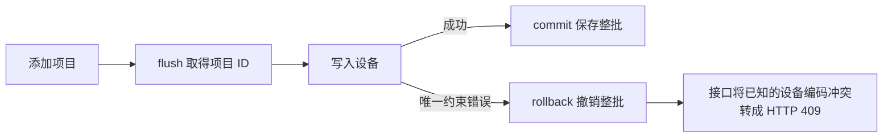

# 实验 02｜一次写入失败，如何避免留下半份数据

## 目标

创建项目并同时导入首批设备。合法请求提交整批数据。设备编码重复时，回滚整批写入，HTTP 接口返回 409。修正设备编码后用同一项目编码重试。

## 事务流程



- `flush()` 执行 SQL，项目 ID 已可用，事务仍可回滚。
- `with session.begin():` 正常退出时提交，异常退出时回滚。每次调用导入函数使用一个 Session。
- 接口检查 psycopg 的 `UniqueViolation` 和约束名 `uq_devices_project_id_code`，只将该设备冲突映射为 409。

## 命令与验收

在课程目录的 CMD 逐行执行。Python 和 Uvicorn 使用已激活的 .venv，DATABASE_URL 指向 p29_lab。

| 操作 | 命令或输入 | 预期 |
|---|---|---|
| 核对迁移 | `python -m alembic current` | 34bc355690e6 (head) |
| 正常导入 | `python import_devices.py` | TX-OK 和两台设备一起提交 |
| 单事务失败 | `python -c "from import_devices import import_project; import_project('TX-FAIL', ['sensor-01', 'sensor-01'])"` | 设备唯一约束报错，TX-FAIL 查询返回 0 行 |
| 分事务对照 | `python split_transaction.py` | 设备事务失败，TX-SPLIT 留下 1 行，设备编码为 NULL |
| 修正后重试 | `python -c "from import_devices import import_project; import_project('TX-FAIL', ['sensor-01', 'sensor-02'])"` | 同一项目编码成功提交两台设备 |
| 启动 HTTP 服务 | `python -m uvicorn api:app --host 127.0.0.1 --port 8000` | 服务启动 |
| 正常 HTTP 请求 | POST /projects/import，HTTP-OK，两种设备编码 | 201 Created |
| 冲突 HTTP 请求 | POST /projects/import，HTTP-FAIL，两次 sensor-01 | 409 Conflict |
| 修正 HTTP 请求 | POST /projects/import，沿用 HTTP-FAIL，改用 sensor-01 和 sensor-02 | 201 Created |

在第二个 CMD 发冲突请求：

```cmd
curl.exe -i -X POST "http://127.0.0.1:8000/projects/import" -H "Content-Type: application/json" -d "{\"project_code\":\"HTTP-FAIL\",\"device_codes\":[\"sensor-01\",\"sensor-01\"]}"
```

在冲突请求和修正重试之间查库：

```cmd
docker compose exec db psql -U p29 -d p29_lab -P "null=NULL" -c "SELECT p.code AS project_code, d.code AS device_code FROM projects p LEFT JOIN devices d ON d.project_id = p.id WHERE p.code = 'HTTP-FAIL';"
```

## 实际观察

- 单事务冲突截图显示 `UniqueViolation`，重复键为 `(project_id, code) = (5, sensor-01)`。随后查询 TX-FAIL 返回 `(0 rows)`，确认项目一起回滚。
- Uvicorn 日志确认 POST 正常请求返回 201、冲突请求返回 409。
- 浏览器地址栏访问根路径返回 404，因为没有注册该路由。地址栏访问 /projects/import 发出 GET，返回 405，因为该路由只接受 POST。用 curl.exe 指定 POST 后得到了预期响应。
- 分事务对照、命令行重试、HTTP 冲突后的查库及 HTTP 重试尚未收到实际输出。表中的结果为验收预期。

## 自测

1. 项目拿到 ID 后，为什么还能撤销？flush 已发出 INSERT，事务还没有提交。
2. 先提交项目，再写入重复设备，LEFT JOIN 返回什么？1 行，右侧设备编码为 NULL。整批回滚时返回 0 行。
3. 分事务失败后，用同一个项目编码从头重试，哪里会先冲突？插入项目时就触发 projects.code 的唯一约束。
4. 谁回滚，谁返回 409？Session 的事务块负责回滚，FastAPI 将捕获并识别的设备冲突转成 409。
